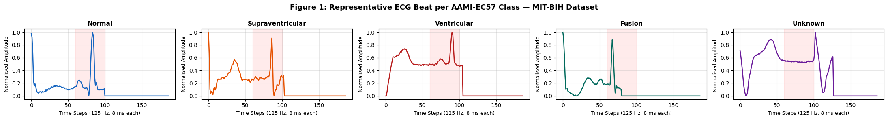
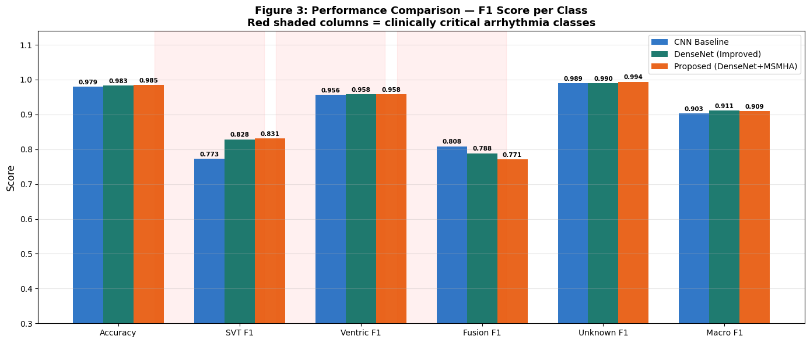
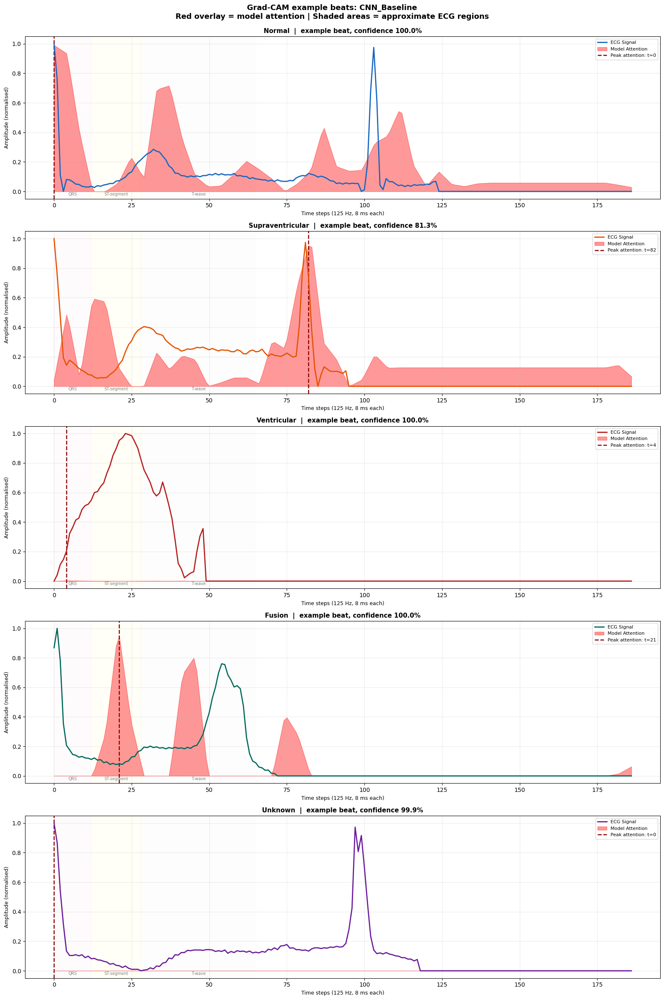
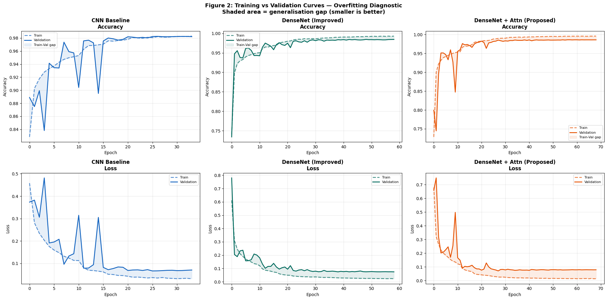

# Explainable Cardiac Arrhythmia Detection

**Three 1D deep-learning models compared on 109,446 MIT-BIH heartbeats, with Grad-CAM to show where the model looks, and an honest account of what the numbers do not prove.**

Five-class heartbeat classification on the MIT-BIH arrhythmia data (Kaggle `shayanfazeli/heartbeat`). A CNN, a DenseNet and a DenseNet with multi-scale attention are trained and compared over two runs, and Grad-CAM is used to look at where a model attends along the beat.

Headline result: with the usual by-beat split, all three models reach 97.9 to 98.7% accuracy and 0.90 to 0.92 macro F1. On a patient-wise split (unseen patients) the same models reach 79 to 81% accuracy and 0.37 to 0.40 macro F1. The by-beat numbers are therefore far too optimistic, and the larger models are not clearly better than the plain CNN in either setting.

## Project and my contribution

Minor project at SRM Institute of Science and Technology (January to May 2026), done in a team of 2 with a faculty mentor.

My part:

- **Data:** dataset handling and preprocessing, including the class-imbalance handling.
- **Training pipeline:** training and debugging the models.
- **Explainability:** the Grad-CAM visualisation and region analysis.

## Dataset

- 87,554 training beats and 21,892 test beats, 187 samples each. The signal is resampled to 125 Hz, so a beat window is about 1.5 s. Each beat starts at its R-peak and is zero-padded, so there is no P-wave in the window.
- Five AAMI classes: Normal, Supraventricular, Ventricular, Fusion, Unknown.
- Severe imbalance in training: Normal 72,471 beats (82.8%) and Fusion 641 (0.7%), about 113 to 1.

## What was done

- **Imbalance handling:** time-shift, amplitude scaling and Gaussian-noise augmentation on the minority classes, plus balanced class weights in the loss.
- **Models:**
  - Baseline 1D CNN with SpatialDropout1D (224,901 parameters)
  - DenseNet-style 1D network with transition layers (318,501 parameters)
  - The same DenseNet with two multi-head self-attention blocks at different temporal scales (442,917 parameters)
- **Evaluation:** accuracy, macro F1, and per-class sensitivity, specificity and PPV. A clinical priority score (Ventricular, then Supraventricular, then Fusion, then accuracy) is used to pick the model for Grad-CAM.
- **Explainability:** Grad-CAM for 1D signals, averaged per approximate ECG region over correctly classified test beats.

## Results (test set, 21,892 beats)

The whole pipeline was run twice with different random initialisation. Both runs are shown, because the ranking changed.

| Model | Accuracy (run 1 / run 2) | Macro F1 (run 1 / run 2) | Fusion F1 (run 1 / run 2) |
|---|---|---|---|
| CNN baseline | 98.19% / 97.93% | 0.910 / 0.903 | 0.814 / 0.808 |
| DenseNet with transition layers | 98.66% / 98.34% | 0.923 / 0.911 | 0.807 / 0.788 |
| DenseNet + multi-scale attention | 98.44% / 98.46% | 0.915 / 0.909 | 0.788 / 0.771 |

What this shows:
- The DenseNet had the best macro F1 in both runs, by about 0.7 to 1.3 points over the CNN.
- The attention model had the best accuracy in run 2 only. Across both runs it never clearly beat the plain DenseNet, and it has the most parameters.
- The simple CNN was best on the rare Fusion class in both runs.
- The accuracy gaps (0.1 to 0.7 points) are about the size of the change between runs, so these models are not clearly separable on accuracy.

Run 2 per-class sensitivity and PPV (Supraventricular and Ventricular are the high-risk classes):

| Model | SVT sensitivity / PPV | Ventricular sensitivity / PPV | Fusion sensitivity / PPV |
|---|---|---|---|
| CNN baseline | 0.845 / 0.712 | 0.974 / 0.939 | 0.846 / 0.774 |
| DenseNet | 0.845 / 0.812 | 0.969 / 0.948 | 0.827 / 0.753 |
| DenseNet + attention | 0.822 / 0.840 | 0.963 / 0.953 | 0.821 / 0.727 |

In run 2 the clinical priority score selected the **CNN baseline** (0.916) for Grad-CAM, ahead of the DenseNet (0.911) and the attention model (0.900).

## Patient-wise evaluation (DS1 / DS2)

The results above use a by-beat split. To see how much that split helps, I repeated the comparison with the patient-wise DS1 / DS2 protocol of de Chazal et al. (2004): 22 recordings for training and 22 different recordings for testing, so no patient is on both sides. Notebook: `inter_patient_evaluation.ipynb`. Full report: `results/inter_patient_run1.txt`.

| Model | By-beat accuracy | By-beat macro F1 | Patient-wise accuracy | Patient-wise macro F1 |
|---|---|---|---|---|
| CNN baseline | 97.93% | 0.903 | 78.76% | 0.374 |
| DenseNet | 98.34% | 0.911 | 80.94% | 0.396 |
| DenseNet + attention | 98.46% | 0.909 | 80.04% | 0.389 |

Patient-wise F1 per class (49,678 test beats):

| Class | Test beats | CNN | DenseNet | DenseNet + attention |
|---|---|---|---|---|
| Normal | 44,232 | 0.884 | 0.892 | 0.886 |
| Supraventricular | 1,837 | 0.050 | 0.080 | 0.035 |
| Ventricular | 3,221 | 0.558 | 0.611 | 0.634 |
| Fusion | 388 | 0.004 | 0.001 | 0.002 |

What this shows:

- **The by-beat split inflated the results a lot.** On unseen patients, macro F1 falls from about 0.90 to about 0.39.
- Ventricular beats are still found (recall 0.87 to 0.89), but with many false alarms (precision 0.41 to 0.50).
- Supraventricular and Fusion beats are essentially not detected on unseen patients.
- Validation accuracy still reached about 99% during training, because the validation beats come from the training patients. A by-beat validation set cannot warn about this.
- As before, the larger models are not clearly better than the CNN.

How to read the comparison:

- It is **not like for like**. The patient-wise run has 4 classes (the paced recordings are excluded, which removes almost all Unknown beats) and cuts the beats from the cardiologist annotations. The by-beat run has 5 classes and uses the Kaggle preprocessing. Read the gap as an indication, not an exact measurement.
- It is **one run** (seed 42).
- A single-beat window carries no rhythm timing. Supraventricular beats are mostly recognised by arriving early, so part of that weak score may come from the input and not only from the split. This was not tested.

## Grad-CAM attention by region (run 2, CNN baseline)

Mean Grad-CAM attention (%) per approximate region, averaged over up to 200 correctly classified test beats per class. Beats with an empty heatmap are excluded.

| Class | QRS (0-12) | ST-segment (12-28) | T-wave (28-65) | Late beat (65+) | Beats used |
|---|---|---|---|---|---|
| Normal | 49.7 | 11.9 | 14.3 | 24.1 | 175 / 200 |
| Supraventricular | 9.8 | 27.4 | 30.3 | 32.4 | 151 / 200 |
| Ventricular | 30.8 | 11.6 | 23.9 | 22.6 | 172 / 200 |
| Fusion | 5.2 | 52.3 | 24.2 | 16.7 | 134 / 137 |
| Unknown | 13.6 | 33.2 | 16.0 | 17.2 | 185 / 200 |

How to read it:
- Normal beats are dominated by the QRS region. Fusion beats put most attention on the ST segment.
- Ventricular attention is spread across the QRS, T-wave and late-beat regions, and Supraventricular attention is diffuse. These do not give a clean clinical story, so this table should not be read as proof that the model uses clinically correct features.
- The region boundaries are approximate. They are read off the class-mean beats, not clinical annotations. The 125 Hz, R-peak-first layout means there is no P-wave to analyse.

## Limitations

- **The split is by beat, not by patient.** The Kaggle train and test files mix beats from the same recordings, so a patient's beats can appear on both sides. This probably inflates the accuracy. A patient-wise split (for example the DS1/DS2 protocol) is the proper test.
- **The patient-wise run is a single run with different preprocessing.** See the section above. Repeating it with more seeds and adding R-R interval features is the next step.
- **Only two runs per model.** That is enough to see that the ranking is unstable, but not to put confidence intervals on the differences.
- **Grad-CAM regions are approximate** (see above), and the Grad-CAM table is for one selected model in one run.
- **An early version of the region analysis was wrong.** It used boundaries meant for a window centred on the R-peak and a single beat per class. Both were fixed in the final notebook.
- **No ablation.** An earlier ablation attempt crashed and was removed, so no ablation results are claimed.
- **Research code, not a diagnostic tool.**

## Training curves

## Run it

1. Open `cardiac_arrhythmia_classification.ipynb` in Kaggle with a GPU and add the dataset `shayanfazeli/heartbeat`.
2. Run all cells. Training the three models takes the longest.

The main notebook is saved with its outputs (run 2), so its numbers and figures can be checked without running it. `inter_patient_evaluation.ipynb` is saved without outputs. Its run log is in `results/inter_patient_run1.txt`. To repeat it, run it on Kaggle with the GPU and Internet on, because it downloads the records from PhysioNet. To run it outside Kaggle, install `requirements.txt` and change the two CSV paths in the data-loading cell.

## Tech stack

TensorFlow/Keras, scikit-learn, NumPy, pandas, Matplotlib, Seaborn.

## References

- Kachuee, Fazeli, Sarrafzadeh. ECG Heartbeat Classification: A Deep Transferable Representation (2018), the source of the dataset.
- Huang et al. Densely Connected Convolutional Networks (CVPR 2017).
- Selvaraju et al. Grad-CAM (ICCV 2017).
